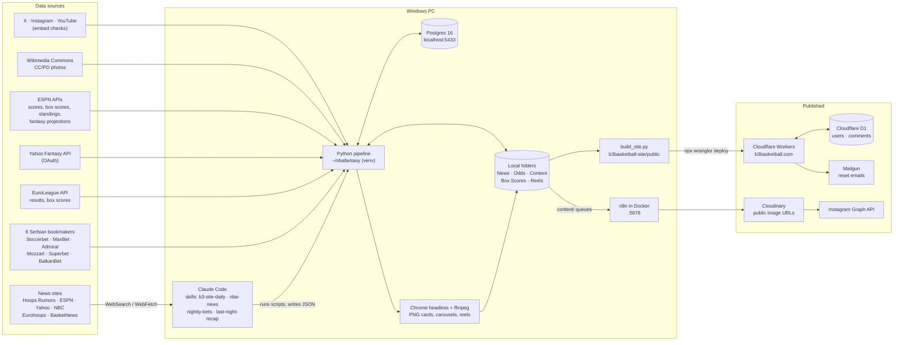
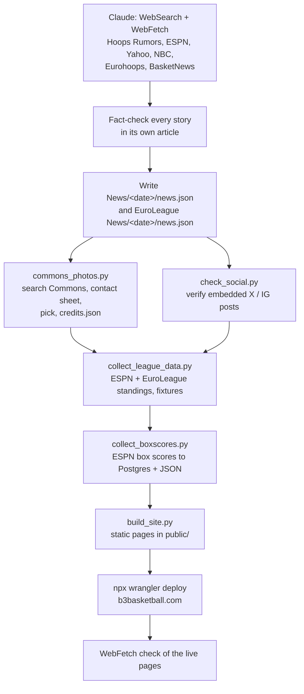
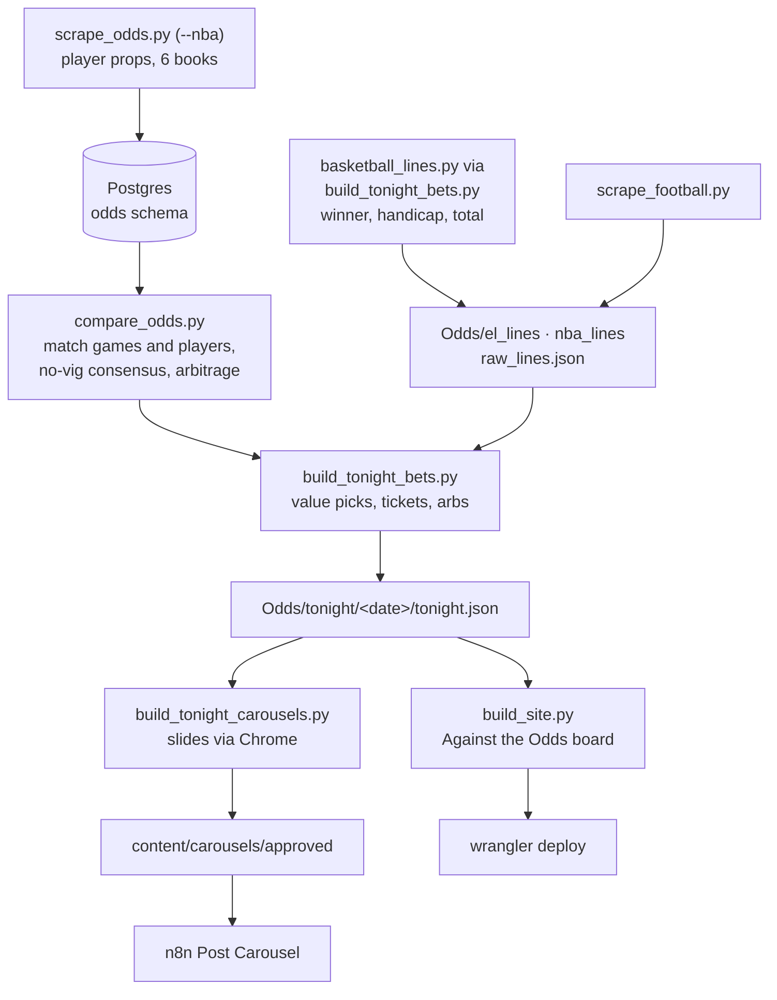
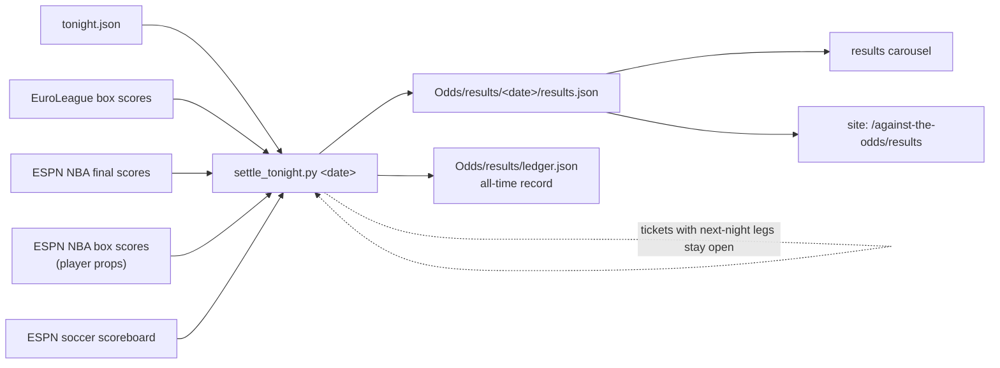
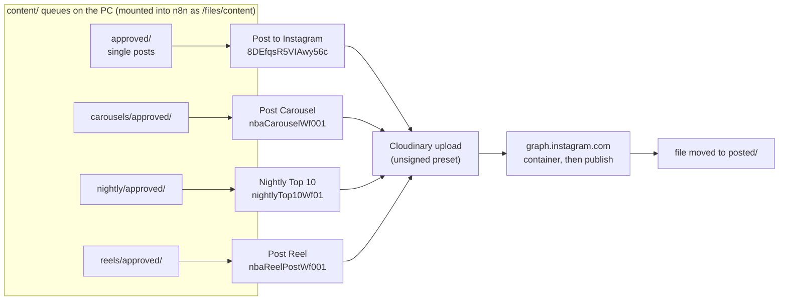
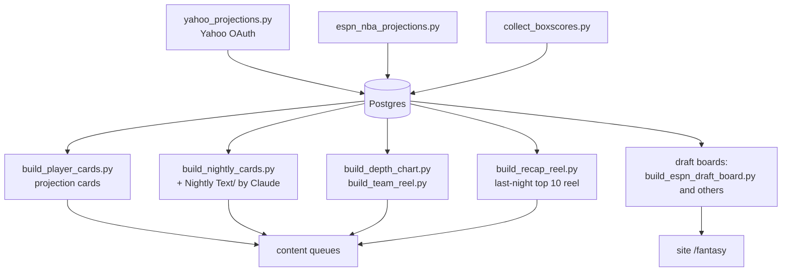
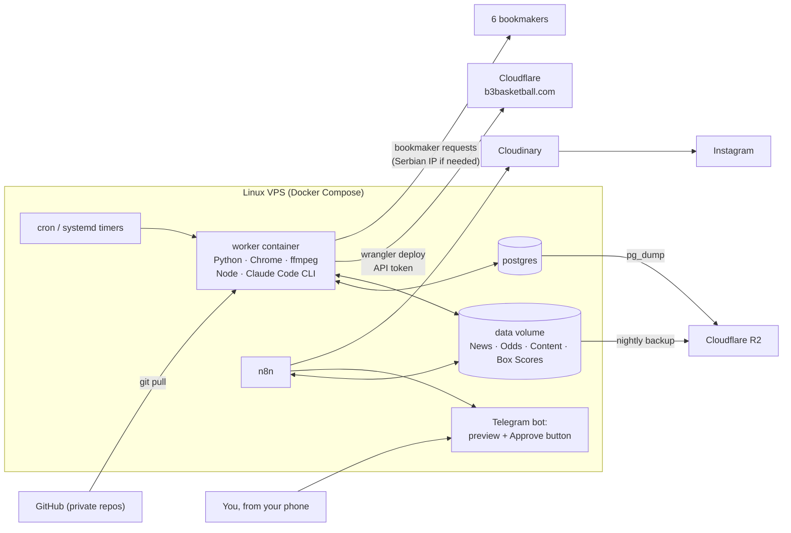

# b3basketball system map

As of 2026-10-20. This file covers everything behind b3basketball.com and its Instagram account: where the data comes
from, what runs on the PC, what Claude does, and how posts and pages get published. The last two sections cover
moving the project off the PC.

Repos: the pipeline is `nbafantasy` (this repo). The website is `b3basketball-site`, a separate repo that is only on
the PC for now.

| | |
|---|---|
| Code folders | 2: `nbafantasy` (pipeline) and `b3basketball-site` (site + Worker) |
| Pipeline code | 51 Python scripts, 22 HTML render templates, 6 bookmaker scrapers |
| External services, APIs and tools | 26 |
| n8n workflows posting to Instagram | 4 |
| Local data and media | about 0.7 GB, on this PC only (after the Oct 20 cleanup) |

## Contents

1. [System context](#system-context)
2. [Process flows](#process-flows)
3. [Integration inventory](#integration-inventory)
4. [n8n workflows](#n8n-workflows)
5. [State and schedule](#state-and-schedule)
6. [Git repositories](#git-repositories)
7. [Running off the PC](#running-off-the-pc)
8. [Migration plan](#migration-plan)

## System context

Today one Windows PC does everything:
- Python scripts pull data into Postgres and JSON files.
- Chrome and ffmpeg render images and reels.
- Claude Code researches and writes.
- Two paths publish the results: **wrangler** deploys the site to Cloudflare, and **n8n** posts to Instagram.



Arrows show how data moves. Everything inside "Windows PC" stops when the PC is off.

## Process flows

| Process | Started by | Output |
|---|---|---|
| 1. Website news | skill `b3-site-daily` (news mode) | b3basketball.com news pages |
| 2. Bets | skills `nightly-bets`, `b3-site-daily` (odds mode) | Against the Odds board, bet carousels |
| 3. Settlement | next morning, `settle_tonight.py <date>` | results page, ledger, results carousel |
| 4. Instagram publishing | n8n, after you approve | posts, carousels, reels |
| 5. Fantasy content | by hand / skill `last-night-recap` | cards, reels, draft boards, `/fantasy` |

### 1. Website news (b3-site-daily, "news" mode)



Instagram news posts (skill `nba-news`) reuse the same stories: news.json → `posts.json` → `build_news_posts.py` →
`content/approved/` → n8n `8DEfqsR5VIAwy56c`, one post every 5 minutes.

### 2. Bets: odds, board, carousels (nightly-bets / b3-site-daily "odds")



NBA player props: only Soccerbet, Superbet and Mozzart offer them so far. Admiral and BalkanBet list NBA games
without props. NBA league IDs in `odds_scrapers/basketball_lines.py` are Superbet 164 and BalkanBet 234 for the
regular season.

### 3. Settlement the next morning



- NBA player props settle from ESPN box scores, cached in `Box Scores/<date>/`.
- Each leg uses its own US Eastern game date.
- A player who did not play (DNP) makes the leg void.
- A ticket with a leg on a later night stays open. Re-run `settle_tonight.py` for that date after the later game.

### 4. Instagram publishing (n8n)



Claude or a shell loop starts the workflows with `docker exec … n8n execute --id=…`. The Nightly Top 10 cron was set
for one night only. Nothing is posted until you approve it.

### 5. Fantasy content



## Integration inventory

Credential key:
- **no auth**: a public endpoint.
- **secret**: needs a credential; the table says where it is stored.
- **risk**: may break when the project moves to a server.

### Sports data

| Service | Used for | How | Credential | Code |
|---|---|---|---|---|
| ESPN site API | Scoreboards, box scores, standings, soccer scores, settlement | site.api.espn.com JSON | no auth | `collect_boxscores.py`, `collect_league_data.py`, `settle_tonight.py` |
| ESPN Fantasy API | Projections, draft board, player outlooks | lm-api-reads.fantasy.espn.com | no auth | `espn_nba_projections.py` |
| ESPN CDN | Headshots, team logos | a.espncdn.com | no auth | `build_nightly_cards.py`, `build_depth_chart.py` |
| Yahoo Fantasy API | Projections, league checks | OAuth 2 via yfpy | secret: `.env` + `tokens.json` | `yahoo_auth.py`, `yahoo_projections.py` |
| EuroLeague API | Results, standings, fixtures, box scores, crests | api-live.euroleague.net, live.euroleague.net | no auth | `collect_league_data.py`, `settle_bets.py` |

### Bookmakers (all Serbian, public JSON)

| Service | Used for | How | Credential | Code |
|---|---|---|---|---|
| Soccerbet, MaxBet | Props, game lines, football | Dualsoft REST `/restapi/offer` | risk: geo / IP | `odds_scrapers/dualsoft.py` |
| AdmiralBet | Props, game lines | srboffer.admiralbet.rs | risk: geo / IP | `odds_scrapers/admiralbet.py` |
| MozzartBet | Props, game lines | POST API through curl (Cloudflare blocks Python's TLS) | risk: Cloudflare bot check | `odds_scrapers/mozzartbet.py` |
| Superbet | Props, game lines | Fastly offer API | risk: geo / IP | `odds_scrapers/superbet.py` |
| BalkanBet | Props, game lines | NSoft distribution API | risk: geo / IP | `odds_scrapers/balkanbet.py` |

### News, photos, embeds

| Service | Used for | How | Credential | Code |
|---|---|---|---|---|
| News sites | Story research and fact-checking | Claude WebSearch / WebFetch | no auth | skills `nba-news`, `b3-site-daily` |
| Wikimedia Commons | CC / public-domain photos with credits | MediaWiki API (rate-limited) | no auth | `commons_photos.py` |
| X, Instagram oEmbed | Check embedded posts before showing them | publish.x.com, instagram.com | no auth | `check_social.py` |
| YouTube | Official highlight video IDs, embeds | search page + oEmbed via curl; youtube-nocookie embeds | no auth | skill, `build_site.py` |

### Website

| Service | Used for | How | Credential | Code |
|---|---|---|---|---|
| Cloudflare Workers + assets | Hosts b3basketball.com, `/api`, video range requests | `npx wrangler deploy` | secret: wrangler login on the PC | `wrangler.jsonc`, `src/worker.js` |
| Cloudflare D1 | Users, comments, password resets, mail log | Worker binding `DB` | via Cloudflare | `migrations/` |
| Mailgun | Password-reset emails | REST from the Worker | secret: Worker secrets `MAILGUN_*` | `src/worker.js` |
| Google Fonts | Site and slide fonts | fonts.googleapis.com | no auth | `build_site.py` |

### Social publishing

| Service | Used for | How | Credential | Code |
|---|---|---|---|---|
| n8n (self-hosted) | Runs the posting workflows | Docker on the PC, port 5678, reads `content/` | secret: n8n credentials store | `n8n Docker/*.json` |
| Cloudinary | Turns local files into public URLs for Instagram | Unsigned upload preset `nbafantasy` | preset name in workflows | n8n workflows |
| Instagram Graph API | Posts, carousels, reels | graph.instagram.com (Instagram Login) | risk: token expires about every 60 days | n8n workflows |

### Local tools and AI

| Service | Used for | How | Credential | Code |
|---|---|---|---|---|
| Claude Code | Research, writing, running the pipeline, approvals | CLI; `claude -p` from `run_daily.cmd` | secret: your Claude login on the PC | `ops/claude-skills/` |
| Postgres 16 | Projections, box scores, odds history | localhost:5433 / nba_fantasy | secret: `DATABASE_URL` in `.env` | SQLAlchemy |
| Chrome headless | Renders every PNG (cards, posts, slides) | Hard-coded Windows path | none | `build_player_cards.find_browser` |
| ffmpeg | Reels | `tools/ffmpeg/bin` | none | `build_*reel*.py` |
| GitHub | Private code repo | `git push`, GitHub CLI (`C:\Users\Zoric\bin\gh.exe`) | secret: gh login on the PC | whole repo |

## n8n workflows

| Workflow | ID | Reads | File |
|---|---|---|---|
| NBA Fantasy - Post to Instagram | `8DEfqsR5VIAwy56c` | `content/approved/` (lowest-sorted .json) | `n8n Docker/instagram_post.json` |
| NBA Fantasy - Post Carousel | `nbaCarouselWf001` | `content/carousels/approved/` | `n8n Docker/carousel_post.json` |
| NBA Fantasy - Nightly Top 10 | `nightlyTop10Wf01` | `content/nightly/approved/` | `n8n Docker/nightly_top10_post.json` |
| NBA Fantasy - Post Reel | `nbaReelPostWf001` | `content/reels/approved/` | `n8n Docker/reel_post.json` |

Run one manually:

```
MSYS_NO_PATHCONV=1 docker exec -e N8N_RUNNERS_BROKER_PORT=5690 n8ndocker-n8n-1 n8n execute --id=<ID>
```

## State and schedule

> **Nothing is scheduled right now.** `b3basketball-site/daily/run_daily.cmd news | odds | morning` exists, and the
> skill describes it as started by Windows Task Scheduler. No scheduled task on this PC points at it, though. Every
> run so far was started from a Claude session. The only timer was the n8n Nightly Top 10 cron, and it was set for a
> single night.

Sizes below were measured after the Oct 20 cleanup.

| State | Where | Size | Needed online? |
|---|---|---|---|
| Postgres: projections, box scores, odds history | localhost:5433 / nba_fantasy | small | Yes: dump and restore |
| Site content: news.json + photos, tonight.json, results, ledger | `News/`, `EuroLeague News/`, `Odds/`, `League/` | ~270 MB | Yes: `build_site.py` reads all of it |
| Box scores (raw ESPN / EuroLeague JSON) | `Box Scores/` | 33 MB | Yes |
| Instagram queues and history | `Content/` | <1 MB | Queues yes; `posted/` can be archived |
| Rendered media | `Reels/`, `Player Cards/`, charts | ~0 (cleared, rebuilt on demand) | Archive only |
| Inputs: headshots, logos, fonts, audio | `headshots/`, `logos/`, `fonts/`, `Reel Audio/` | ~190 MB | Yes |
| Secrets | `.env`, `tokens.json`, n8n credentials, wrangler login, Worker secrets, gh login | tiny | Yes: move by hand, never through git |

## Git repositories

Both repos hold code only. Data, media, the venv, ffmpeg and secrets are ignored. `nbafantasy` uses a whitelist
`.gitignore`, so a new top-level folder stays out of git until it is listed there.

| Repo | Remote | Tracked | Ignored |
|---|---|---|---|
| `C:\Users\Zoric\nbafantasy` | https://github.com/branislavzoric/nbafantasy (private, `main`) | Python scripts, HTML templates, `odds_scrapers/`, `tools_fb/`, n8n workflow JSON + compose file, fonts, logos, config JSON, `ops/claude-skills/` (copies of the 4 skills), `docs/`, `.env.example`, `requirements.txt` | `.env`, `tokens.json`, `venv/`, `tools/` (ffmpeg), all data and media folders, `Odds/football` |
| `C:\Users\Zoric\Desktop\b3basketball-site` | none yet (local only) | `build_site.py`, `fantasy_guide.py`, `src/worker.js`, `migrations/`, `wrangler.jsonc`, `daily/run_daily.cmd` | `public/` (build output), `.wrangler/`, logs |

Football code in `Odds/football` is not in focus and stays on the PC only.

Day to day:

```
git add -A
git commit -m "..."
git push
```

## Running off the PC

Three things tie the project to this machine:
- the **files**: data, queues, media
- the **processes**: Postgres, n8n, Chrome, ffmpeg, Claude Code
- the **logins**: Claude, Cloudflare, Yahoo, Instagram

The simplest path moves all three to one small Linux server. Everything else stays where it is: the site on
Cloudflare, and posting through n8n, Cloudinary and Instagram.

### Options

**Recommended: one Linux VPS with Docker**
- One Docker Compose file runs Postgres, n8n and a "worker" container with Python, Chrome, ffmpeg, Node and the
  Claude Code CLI.
- Cron or systemd timers start `claude -p "Run the b3-site-daily skill…"` and the settle and collect scripts.
- The file layout stays the same as today, so n8n keeps reading `content/` from a shared volume.
- Size: 4 vCPU / 8 GB in an EU data centre, roughly €10–20 a month.
- Backups: a nightly `pg_dump` plus the data folders, copied to Cloudflare R2.

**More rework: GitHub Actions + managed services**
- Scheduled Actions run the scripts and Claude (claude-code-action), n8n Cloud posts, and Neon or Supabase hosts
  Postgres.
- Runners are short-lived, so every file the pipeline keeps would first have to move to R2.
- Runner IPs are mostly in the US, and the Serbian bookmakers may block them.
- Still a good fit later for code checks and site deploys.

**Partial: Claude cloud routines**
- Scheduled Claude agents in Anthropic's cloud can research and write on a timer.
- They have no Postgres, n8n or local files, so they can't run the pipeline on their own.
- They could take over the news research step if they push their JSON to the repo or to R2.

### Target layout



> **Check before you pay for anything: can a data centre reach the bookmakers?** All six books are Serbian, and
> Mozzart already sits behind a Cloudflare bot check. Run the scrapers once from a trial server. If they are blocked,
> use a Serbian VPS. The other option is to send only the bookmaker requests through a small device at home (a
> Raspberry Pi) or a residential proxy.

> **Approvals need a new home.** Today you approve posts in the Claude chat. On a server, n8n can send the rendered
> slides to Telegram with Approve and Skip buttons. Files move into the `approved/` queues only after you press Approve.

> **Claude Code runs headless on Linux.** Install the CLI on the server. Sign in with an Anthropic API key (pay per
> use, with a spend limit) or with a long-lived token from your subscription (`claude setup-token`). Copy the four
> skills from `ops/claude-skills/` in the repo to `~/.claude/skills/`.

## Migration plan

1. **Push the repos to private GitHub repositories.** Done for `nbafantasy`. `b3basketball-site` is still
   local only.
2. **Remove the Windows-only parts.** Replace hard-coded paths with environment variables (`PROJECT_DIR`,
   `SITE_DIR`, `CHROME_BIN`, `FFMPEG_BIN`). These hard-code `C:\Users\Zoric` or Chrome's path:
   `build_player_cards.py`, `build_board_carousels.py`, `build_draft_board.py`, `build_highlight_reel.py`,
   `tools_fb/*.py`, `run_daily.cmd` and the skills. Port `run_daily.cmd` to `run_daily.sh`.
3. **Build the worker image and test it on this PC** in Docker Desktop: render one card and one carousel, then build
   the site.
4. **Rent a trial server and test the bookmakers from it:** run `scrape_odds.py` and the line scrapers, then pick the
   hosting location based on the result.
5. **Move the state.** Restore a `pg_dump` on the server. Copy `News/`, `EuroLeague News/`, `Odds/`, `League/`,
   `Box Scores/`, `headshots/` and the `Content/` queues. Export the n8n workflows and credentials, then import them.
6. **Move the logins by hand:** `.env`, `tokens.json`, a Cloudflare API token for wrangler, the Claude key or token,
   and the Instagram token in n8n. Add an n8n workflow that refreshes the Instagram token before its 60 days run out.
7. **Schedule it:**
   - morning settle and box scores
   - the news run
   - the odds run before EuroLeague and NBA tip-offs
   - a weekly database backup to R2

   Also add a failure alert (n8n to Telegram or email) and a heartbeat check.
8. **Run both setups side by side for a week,** then use the PC for development only.
