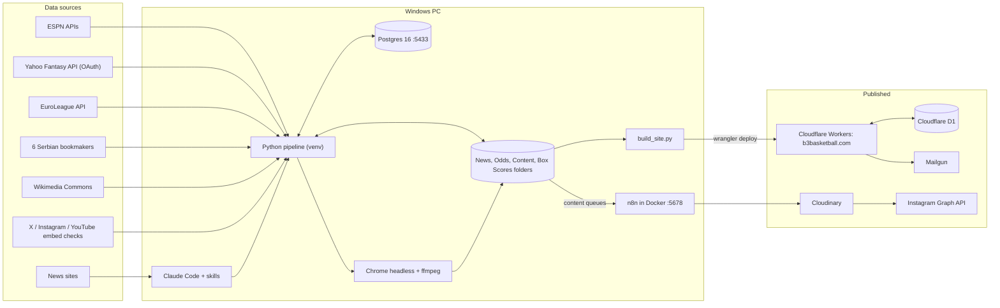
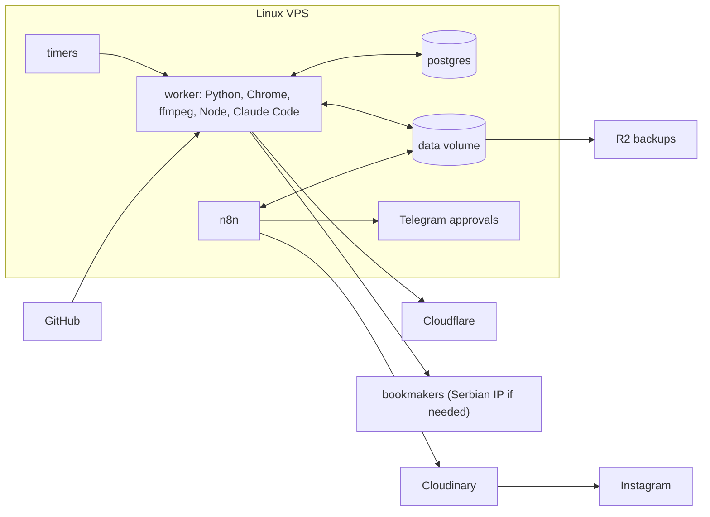

# b3basketball architecture

As of 2026-10-20. Covers the pipeline (`nbafantasy`, this repo) and the website (`b3basketball-site`, separate repo).

## System context

## Processes

| Process | Started by | Steps | Output |
|---|---|---|---|
| Website news | skill `b3-site-daily` (news) | research + fact-check → `News/<date>/news.json`, `EuroLeague News/<date>/news.json` → `commons_photos.py` → `check_social.py` → `collect_league_data.py` → `collect_boxscores.py` → `build_site.py` → `wrangler deploy` | b3basketball.com |
| Instagram news posts | skill `nba-news` | news.json → `posts.json` → `build_news_posts.py` → `content/approved/` → n8n `8DEfqsR5VIAwy56c` (5 min apart) | single posts |
| Bets | skills `nightly-bets`, `b3-site-daily` (odds) | `scrape_odds.py [--nba]` → Postgres `odds` → `compare_odds.py` → `build_tonight_bets.py` (+ game lines, football) → `tonight.json` → board on the site + `build_tonight_carousels.py` → `content/carousels/approved/` → n8n `nbaCarouselWf001` | Against the Odds page, carousels |
| Settlement | next morning | `settle_tonight.py <date>` (EuroLeague box scores, ESPN NBA scores + box scores, ESPN soccer) → `Odds/results/<date>/results.json`, `ledger.json`, results carousel | results page, carousel |
| Last-night recap | skill `last-night-recap` | `collect_boxscores.py` → top 10 by Yahoo points → `Nightly Text/` → `build_recap_reel.py` → `content/reels/` → n8n `nbaReelPostWf001` | reel |
| Fantasy content | by hand | `yahoo_projections.py`, `espn_nba_projections.py` → Postgres → player cards, depth charts, team reels, draft boards | posts, `/fantasy` |

## Integrations

| Service | Used for | Credential | Code |
|---|---|---|---|
| ESPN site API | scores, box scores, standings, soccer, settlement | none | `collect_boxscores.py`, `collect_league_data.py`, `settle_tonight.py` |
| ESPN Fantasy API | projections, draft board | none | `espn_nba_projections.py` |
| ESPN CDN | headshots, logos | none | card builders |
| Yahoo Fantasy API | projections | `.env` (`YAHOO_CLIENT_ID/SECRET`) + `tokens.json` | `yahoo_auth.py`, `yahoo_projections.py` |
| EuroLeague API | results, box scores, crests | none | `collect_league_data.py`, `settle_bets.py` |
| Soccerbet, MaxBet | props, lines, football | none (Serbian IP may matter) | `odds_scrapers/dualsoft.py` |
| AdmiralBet | props, lines | none | `odds_scrapers/admiralbet.py` |
| MozzartBet | props, lines | none, via curl (Cloudflare) | `odds_scrapers/mozzartbet.py` |
| Superbet | props, lines | none | `odds_scrapers/superbet.py` |
| BalkanBet | props, lines | none | `odds_scrapers/balkanbet.py` |
| News sites | research | none (Claude WebSearch/WebFetch) | skills |
| Wikimedia Commons | photos | none | `commons_photos.py` |
| X / Instagram oEmbed | embed checks | none | `check_social.py` |
| YouTube | highlight IDs, embeds | none | skills, `build_site.py` |
| Cloudflare Workers + assets | website | wrangler login (PC) | site repo |
| Cloudflare D1 | users, comments, resets | Cloudflare | site `migrations/` |
| Mailgun | reset emails | Worker secrets `MAILGUN_*` | site `src/worker.js` |
| n8n | posting workflows | n8n credential store | `n8n Docker/` |
| Cloudinary | public image URLs | unsigned preset `nbafantasy` | n8n workflows |
| Instagram Graph API | posts, carousels, reels | token in n8n (~60-day expiry) | n8n workflows |
| Claude Code | research, writing, orchestration | Claude login | `ops/claude-skills/` |
| Postgres 16 | projections, box scores, odds | `DATABASE_URL` | SQLAlchemy |
| Chrome headless | PNG rendering | none | `build_player_cards.find_browser` |
| ffmpeg | reels | none | `tools/ffmpeg/bin` |

## n8n workflows

| Workflow | ID | Reads | File |
|---|---|---|---|
| NBA Fantasy - Post to Instagram | `8DEfqsR5VIAwy56c` | `content/approved/` (lowest-sorted .json) | `instagram_post.json` |
| NBA Fantasy - Post Carousel | `nbaCarouselWf001` | `content/carousels/approved/` | `carousel_post.json` |
| NBA Fantasy - Nightly Top 10 | `nightlyTop10Wf01` | `content/nightly/approved/` | `nightly_top10_post.json` |
| NBA Fantasy - Post Reel | `nbaReelPostWf001` | `content/reels/approved/` | `reel_post.json` |

Run one with `MSYS_NO_PATHCONV=1 docker exec -e N8N_RUNNERS_BROKER_PORT=5690 n8ndocker-n8n-1 n8n execute --id=<ID>`.

## State and storage (not in git)

| State | Where | Size |
|---|---|---|
| Postgres | `localhost:5433/nba_fantasy` | small |
| Site content | `News/`, `EuroLeague News/`, `Odds/`, `League/` | ~815 MB |
| Box scores | `Box Scores/` | 33 MB |
| Instagram queues + history | `Content/` | 379 MB |
| Rendered media | `Reels/`, `Player Cards/`, charts | ~400 MB |
| Inputs | `headshots/`, `logos/`, `fonts/`, `Reel Audio/` | ~190 MB |
| Secrets | `.env`, `tokens.json`, n8n credentials, wrangler login, Worker secrets | – |

## Schedule

No Windows scheduled task points at `b3basketball-site/daily/run_daily.cmd` today, so every run is started from a
Claude session. The n8n Nightly Top 10 cron was set for a single night.

## Off-PC target (recommended)

One Linux VPS with Docker Compose: `postgres`, `n8n` and a `worker` image (Python, Chrome, ffmpeg, Node, Claude Code CLI)
sharing a data volume with today's folder layout. Cron/systemd timers start `claude -p` runs and the collect/settle
scripts; `wrangler deploy` uses a Cloudflare API token; backups go to Cloudflare R2; approvals move to a Telegram bot in
n8n.

Before migrating:
1. Test the six bookmakers from a data-centre IP (Mozzart already uses a Cloudflare bot check).
2. Replace hard-coded Windows paths with env vars (`PROJECT_DIR`, `SITE_DIR`, `CHROME_BIN`, `FFMPEG_BIN`):
   `build_player_cards.py`, `build_board_carousels.py`, `build_draft_board.py`, `build_highlight_reel.py`,
   `tools_fb/*.py`, `run_daily.cmd`, the skills.
3. Add an Instagram token refresh workflow (60-day expiry).
